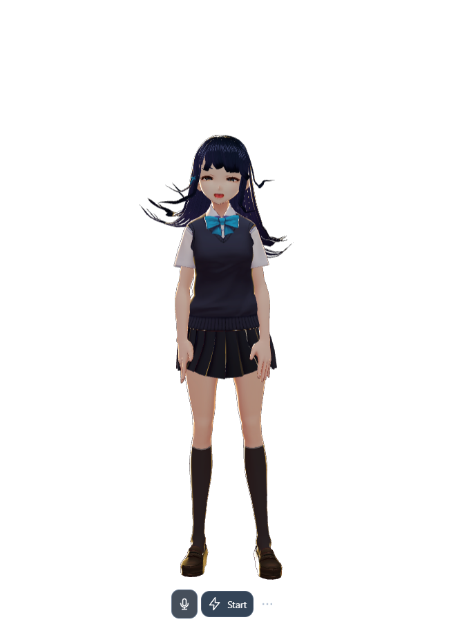

# Kurze Demonstration



Standardavatar im Testbetrieb ohne KI-Inferenz. Die Weboberflaeche und die Begruessungsanimation wurden in Windows Sandbox geprueft.

1. OMOI Mini starten: Der Standardavatar erscheint.
2. Ueber das Drei-Punkte-Menue Sprache, STT, LLM und TTS einstellen.
3. Textchat oder Mikrofon verwenden, wenn die passenden Dienste eingerichtet sind.
4. Bei lokalen Modellen kann die Start-Schaltflaeche die ausgewaehlten Dienste vorbereiten. Modelle und externe Laufzeiten werden separat eingerichtet.

Die automatische Speicheranpassung des lokalen Sprachmodells ist implementiert. Die Hardwarepruefung steht noch aus.

## Vorfuehrung ohne KI-Dienste

Nach der Installation gemaess [README](../README.md) kann ein eigenes
Demo-Profil verwendet werden (PowerShell im Quellordner):

```powershell
$env:OMOI_MINI_DATA_DIR = Join-Path $env:LOCALAPPDATA "OMOI-Mini-Demo"
.\start.bat
```

Unter Einstellungen Sprachausgabe deaktivieren (TTS: Ohne Sprachausgabe).
Kein Mikrofon, Modellstart oder API-Schluessel notwendig. Im Textchat:

- Notiere bitte OMOI Mini Test
- Was habe ich mir notiert?
- Timer auf 30 Sekunden
- Stoppe den Timer

Oberflaechensprache umschalten und die statische Laufzeitdiagnose zeigen.
Diese lokale Demonstration prueft UI, Python-Bridge, Controller, Datenbank
und Avatar. Keine Aussage ueber reale STT-, LLM- oder TTS-Qualitaet.
